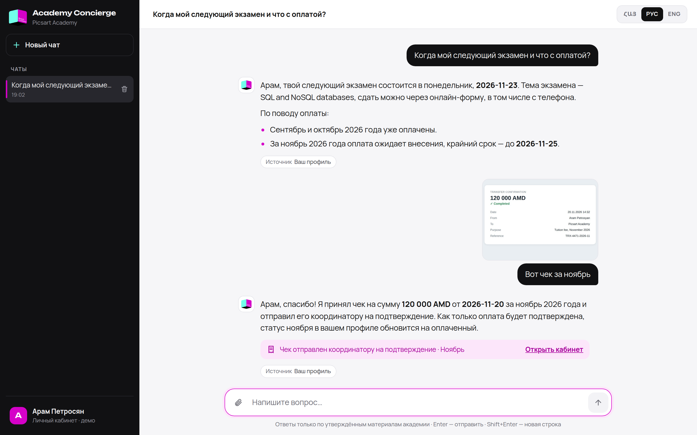

# Academy Concierge

The Picsart Academy assistant for applicants and students — **Student Fellowship Program, Project 14 (Academy Chatbot)**.

It answers in **Armenian, Russian and English** (Armenian typed in Latin letters works too), only from approved Academy content. When it doesn't know, it says so and hands the question to a coordinator instead of guessing.



## What it does

| | |
| --- | --- |
| **Grounded answers** | Every answer comes only from `knowledge/*.md` (programs, schedule, FAQ, contacts) and shows its sources. The answer streams in word by word. |
| **Three languages** | Replies in the language of the question; the interface switches between ՀԱՅ / РУС / ENG. |
| **Chat history** | Every conversation is saved; reopen, continue or delete it from the sidebar. Chats started as a guest move into the account on sign-in. |
| **Accounts** | Sign up with email and password, or continue as a demo student (each visitor gets a private copy). |
| **Personal account** | Schedule, next exam, attendance, payments, absence notes. |
| **Payment receipts** | Send a photo of a receipt in the chat or from the account: the model reads the amount, date and reference, and a coordinator confirms it — then the month shows as paid. |
| **Human handoff** | Questions outside the knowledge base, or facts not confirmed yet, go to a coordinator with the whole conversation. |
| **Entry-test booking** | When an applicant wants to apply, the bot offers a form; the request is saved as a lead with the chat attached. |
| **Coordinator panel** (`/admin`) | Receipts to confirm, handoffs with the conversation, leads, absence notes, users — and an **inbox assistant** that drafts replies to student emails from the knowledge base, leaving `[placeholders]` for facts it does not have. |

## Demo access

- **Continue as a demo student** in the sign-in window — no password; demo accounts are removed after 2 days.
- Coordinator panel: `/admin`, with the `ADMIN_KEY` from the hosting settings.

## How it is built

```
browser ──► Express ──► /api/chat (server-sent events) ──► Gemini (OpenAI-compatible API)
  React       │                ▲
  (Vite)      │   system prompt = rules + knowledge/*.md + the student's profile + attached images
              └──► SQLite: users · sessions · conversations · messages · attachments ·
                   payment_proofs · leads · handoffs · absence notes
```

- **Web app:** React + Vite (`web/`), built into `web/dist` and served by the same server.
- **Server:** Node 24 + Express (`server/`), SQLite through the built-in `node:sqlite`.
- **Model:** any OpenAI-compatible endpoint, set by `LLM_BASE_URL`, `LLM_API_KEY`, `CHAT_MODEL`. In production: Gemini directly. In development: a local OmniRoute gateway.
- **Answer format:** the model writes the reply first, then a `@@META@@{…}` line with language, sources, confidence, handoff flag, suggested action and the fields read from a receipt. The server streams the reply and parses the metadata.
- **Security:** passwords hashed with scrypt; sessions in HttpOnly cookies, only a hash of the token stored; every chat, file and receipt checked against its owner; rate limits on chat, sign-in and uploads; only images and PDFs accepted.
- **Hosting:** one free Render web service (`render.yaml`).

## API

| Method | Path | Purpose |
| --- | --- | --- |
| POST | `/api/chat` | `{message, conversationId?, attachmentIds?, uiLang}` → stream: `start`, `delta`…, `done` |
| GET/DELETE | `/api/conversations[/:id]` | Chat history |
| POST/GET | `/api/attachments[/:id]` | Upload or open an image / PDF |
| POST | `/api/auth/signup` · `login` · `demo` · `logout`; GET `/api/auth/me` | Accounts |
| GET | `/api/me/cabinet` | Personal account data |
| POST | `/api/payments/proof` | Receipt from the personal account |
| POST | `/api/lead` · `/api/excuse` | Entry-test request · absence note |
| GET/POST | `/api/admin/*` | Coordinator panel (header `x-admin-key`) |

## Run locally

```bash
npm run build
LLM_BASE_URL=https://generativelanguage.googleapis.com/v1beta/openai LLM_API_KEY=<key> CHAT_MODEL=gemini-flash-latest npm start
# open http://localhost:8080
```

Without `LLM_*` variables the server uses a local OmniRoute gateway at `http://127.0.0.1:20128/v1`.

## Limits of this demo

- Student profiles are generated demo data; real ones would come from the Academy Core Engine (Project 1), and payments from the Payment Suite (Project 6).
- On Render's free plan the service sleeps after 15 minutes without traffic (the first request then takes up to a minute), and the SQLite data is reset when the service restarts.
- Telegram and Slack are the next step: the chat API does not depend on the channel, so they are thin adapters on top of `/api/chat`.

Logo and brand colours © Picsart Academy.
